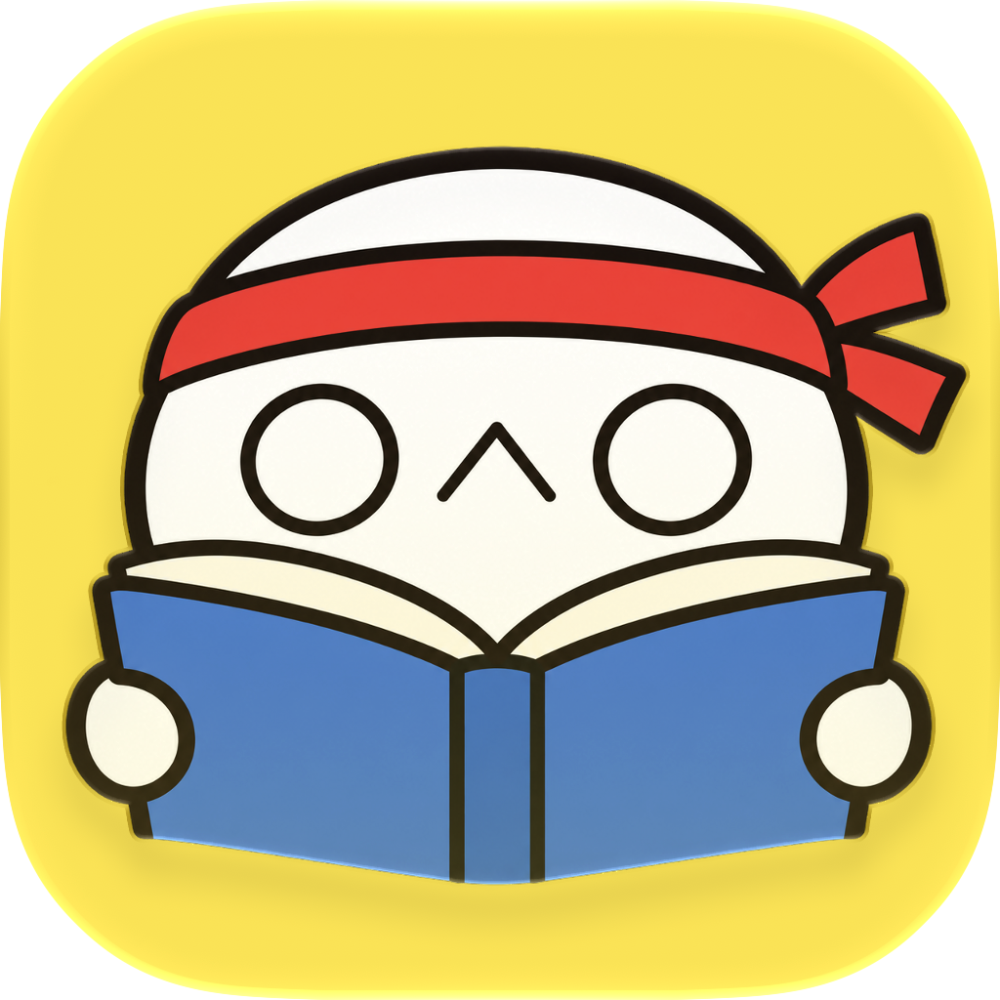
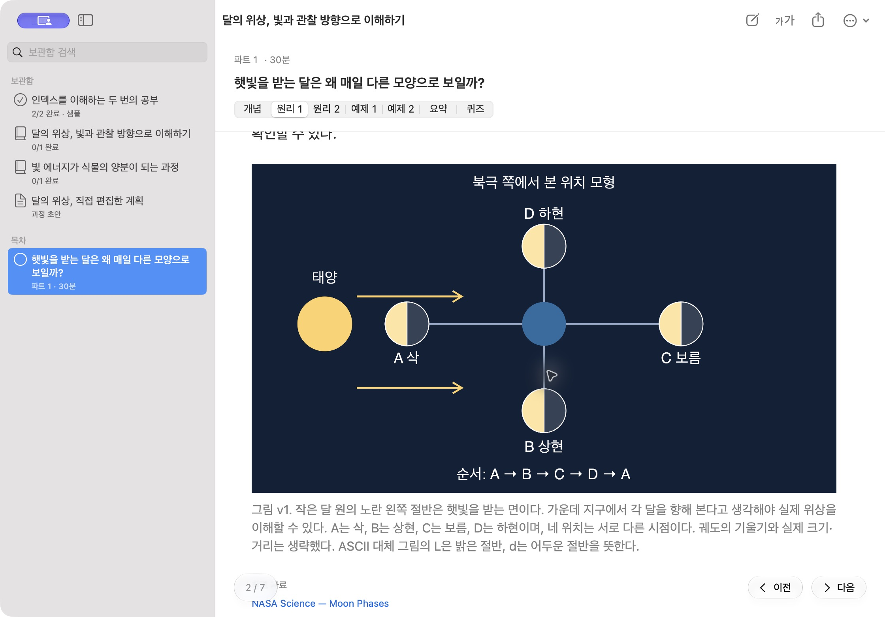
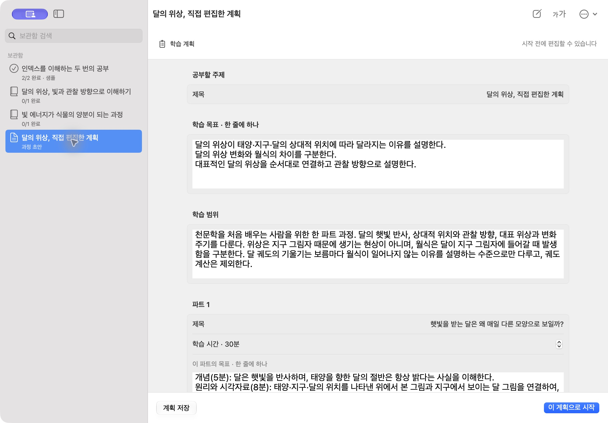
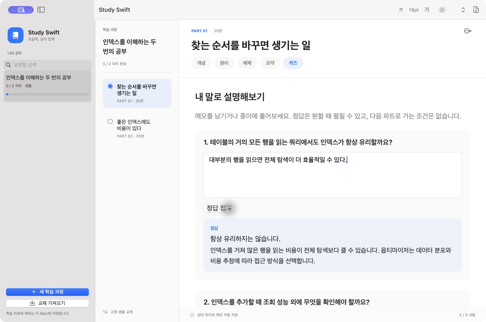

<p align="center">
  
</p>

<h1 align="center">배우자</h1>
<p align="center"><strong>Let’s Learn</strong></p>
<p align="center">
  궁금한 주제를 나만의 교재로, 배운 내용은 퀴즈로.<br>
  교재와 시각자료를 만들고 복습하는 macOS 학습 앱.
</p>

<p align="center">
  <a href="#시작하기">시작하기</a> &nbsp; / &nbsp;
  <a href="docs/usage.md">사용 안내</a> &nbsp; / &nbsp;
  <a href="docs/development.md">개발 안내</a>
</p>

<p align="center">
  <a href="docs/assets/diagram.png"></a>
</p>
<p align="center"><sub>설명과 그림을 함께 읽으며, 궁금했던 원리를 이해해보세요.</sub></p>

<p align="center">
  <a href="docs/assets/plan.png"></a>
  <a href="docs/assets/quiz.png"></a>
</p>
<p align="center"><sub>내게 맞게 계획하기 / 퀴즈와 메모로 복습하기</sub></p>

위 화면은 이전 버전에서 촬영한 실제 생성 교재와 QA 메모의 학습 예시입니다. 최근 표와 PDF 화면, 캡처 정보는 [QA 기록](docs/qa.md)에 있습니다.

## 이렇게 공부해요

1. **궁금한 주제를 적습니다.** 과학, 역사, 언어처럼 배우고 싶은 주제로 시작합니다.
2. **학습 계획을 다듬습니다.** AI가 제안한 목표와 범위를 조정하고, 30~45분 분량의 파트로 나눕니다.
3. **그림과 함께 읽습니다.** 설명, 개념도와 삽화를 보며 공부하고 필요한 내용을 메모합니다.
4. **퀴즈로 확인합니다.** 먼저 직접 풀어본 뒤, 원하는 때 정답과 해설을 펼칩니다.

## 읽기부터 복습까지

- **이해를 돕는 시각자료** — 개념도, 흐름도와 삽화를 교재 안에서 함께 보고 크게 열어볼 수 있습니다.
- **필요한 만큼 교재 준비** — 한 과정의 남은 교재를 한 번에 준비하고, 취소 후에도 완성된 자료부터 이어갑니다.
- **내게 편한 읽기 화면** — 글자 크기를 14~36pt로 조절하고 밝은 테마, 어두운 테마 또는 시스템 설정을 선택합니다. 방향키로 페이지를 넘길 수 있습니다.
- **공부한 내용 보관** — 읽던 위치와 메모를 자동 저장합니다. 교재를 가져오거나 전체 또는 선택 파트를 개별 PDF와 병합 PDF로 내보냅니다.

버전별 변경은 [변경 이력](CHANGELOG.md)에서 확인할 수 있습니다.

## 시작하기

빌드 환경과 도구 설정은 [개발 안내](docs/development.md#빌드-환경)를 참고하세요.

```sh
git clone https://github.com/zzoe2346/baeuja.git
cd baeuja
swift run PackageApp --release
open "dist.noindex/배우자.app"
```

계속 사용할 앱은 `/Applications/배우자.app`에 복사해 실행합니다. 업데이트와 개발용 사본 정리는 [개발 안내](docs/development.md#앱-설치와-개발용-사본)를 참고하세요.

처음에는 **샘플 교재 둘러보기**로 로그인 없이 읽기 기능을 살펴볼 수 있습니다.

새 교재를 만들려면 [Codex CLI](https://developers.openai.com/codex/cli)를 설치하고 기존 ChatGPT 구독으로 로그인합니다.

```sh
codex login
```

**새 과정**에서 주제를 입력하고 학습 계획을 확인한 뒤 시작하세요. 생성에는 인터넷 연결이 필요하며 구독 한도가 적용됩니다. 준비된 교재는 다시 생성하지 않고 읽을 수 있습니다.

macOS 14 이상을 대상으로 합니다. 현재 실행을 확인한 환경은 macOS 27.0.1의 Apple Silicon Mac입니다. 다른 OS와 Intel Mac은 아직 확인하지 않았으며, 로컬 빌드는 ad-hoc 서명을 사용하는 공증되지 않은 앱입니다. [호환성 안내](docs/compatibility.md)

CLI 경로 설정, 단축키, 그림 복구와 저장 위치는 [사용 안내](docs/usage.md)에 정리했습니다.

## 개발과 문서

```sh
./scripts/check.sh
```

[요구사항](docs/requirements.md) / [개발 안내](docs/development.md) / [QA 기록](docs/qa.md) / [개발 지침](AGENTS.md) / [에이전트 운영 안내](docs/agent-workflow.md)

프로젝트는 [Study TUI](https://github.com/zzoe2346/study-tui)의 학습 흐름을 이어받았습니다. CS 개념과 프로젝트 경험을 꼬리 질문으로 연습하고 싶다면, 함께 만든 학습 앱 [꼬꼬무 — Kkokkomu](https://github.com/zzoe2346/kkokkomu)도 살펴보세요.

## 라이선스

[MIT](LICENSE). 포함된 Mermaid 런타임의 라이선스는 [별도 고지](Sources/StudyCore/Resources/NOTICE.md)에 있습니다.
